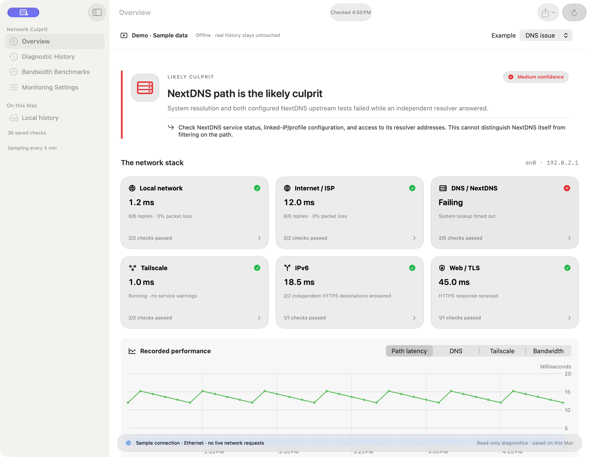
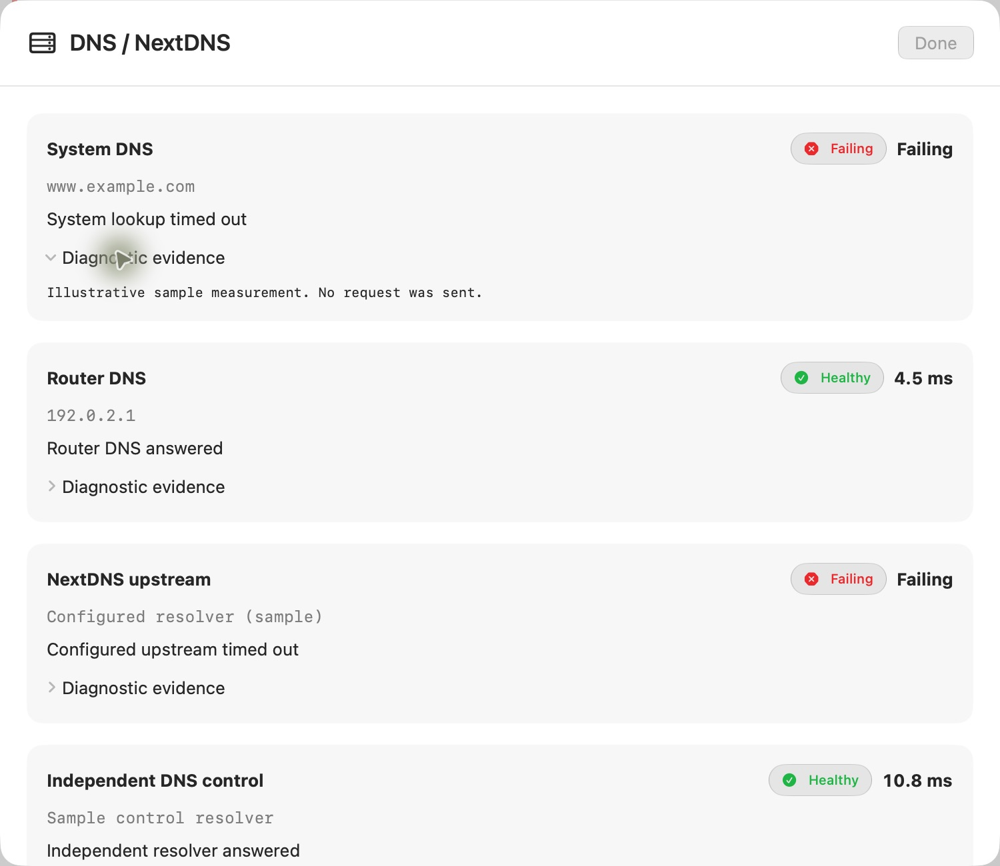
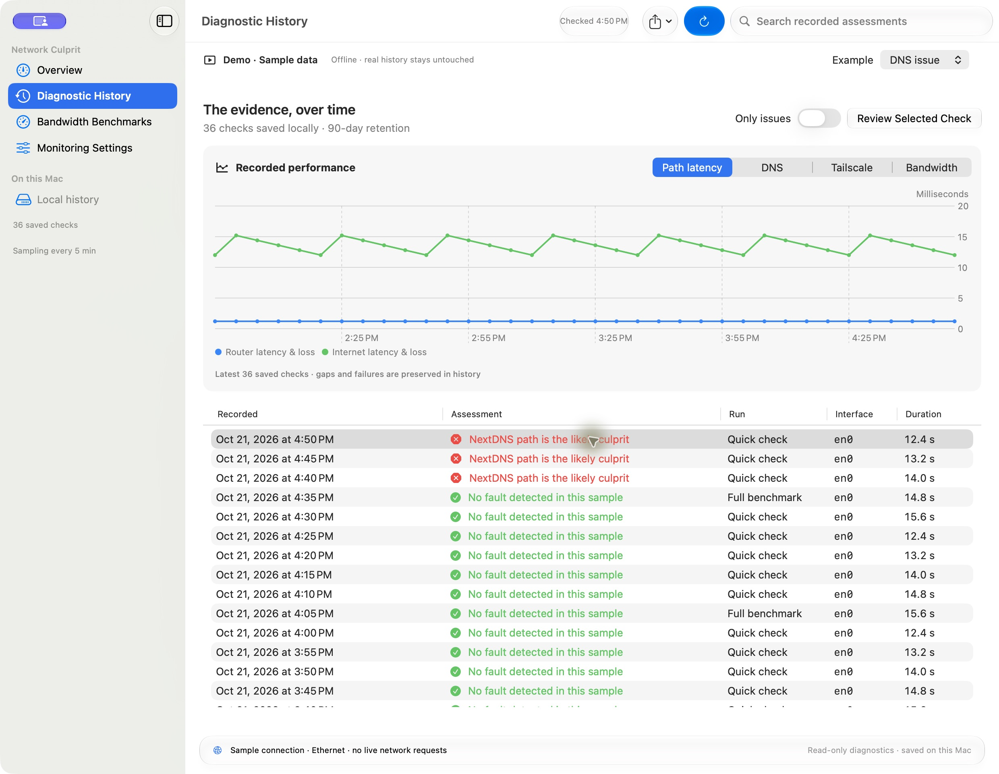

# Network Culprit

**Know where to look when your internet gets flaky.**

Network Culprit is a free, native Mac menu bar app that compares your router, internet connection, DNS, NextDNS, Tailscale, IPv6, and web requests. It keeps the evidence over time, so an intermittent problem has somewhere to leave a trace.

[Download the latest release](https://github.com/andresark/network-culprit/releases/latest) · [Report a bug](https://github.com/andresark/network-culprit/issues) · [Security & automatic updates](SECURITY.md)

  [](LICENSE) [](https://github.com/andresark/network-culprit/actions/workflows/validate-and-release.yml)



*Real app screens, with clearly labeled offline sample data. No personal network history appears in these screenshots.*

## Get started in a minute

1. Download the app ZIP from [Releases](https://github.com/andresark/network-culprit/releases/latest), unzip it, and move **Network Culprit.app** to **Applications**. Requires **macOS 27 or later and Apple Silicon**.
2. Open it and allow **Local Network** access when macOS asks.
3. Find its colored icon in the menu bar and choose **Open Network Dashboard**. The first check usually takes 10–20 seconds.

The free build is ad hoc signed and **not Apple notarized**. macOS may require you to approve its first launch; [Apple explains that decision and the steps here](https://support.apple.com/guide/mac-help/open-a-mac-app-from-an-unknown-developer-mh40616/mac). You can also [build it yourself](#build-it-yourself). Each release includes a SHA-256 checksum for its ZIP.

No account, subscription, or cloud dashboard to set up.

## A quick tour

### 1. Start with the assessment

The Overview puts the likely culprit at the top, together with its confidence, supporting measurements, and a practical next step. The cards underneath show which neighboring layers still work.

| Layer | What you're comparing |
| --- | --- |
| **Local network** | Active connection, router latency/loss, interface errors, and available Wi-Fi signal information |
| **Internet / ISP** | Independent public IP and HTTPS paths, even when ordinary DNS is failing |
| **DNS / NextDNS** | Your system resolver, router, configured NextDNS upstreams, and independent DNS controls |
| **Tailscale** | Service health, transport information, and reachability of a selected tailnet peer |
| **IPv6** | Reachability from each usable source prefix, including an older range left behind after a router restart |
| **Web / TLS** | A normal HTTPS request through the Mac's DNS, proxy, and TLS path |

The assessment is a starting point backed by evidence. One Mac cannot always separate an ISP failure from a router WAN/ONT problem, and a dropped ICMP reply alone does not prove an outage.

### 2. Open a card to see why

Click **DNS / NextDNS**, for example, to compare individual resolver results. In this sample, the system and configured upstreams time out while an independent resolver responds. That gives you a much narrower place to investigate.



Each row includes its target, result, timing, and expandable evidence. You can inspect a saved check in exactly the same way later.

**NextDNS users:** enter your own resolver IPs in **Monitoring Settings → DNS / NextDNS & HTTPS**. Leaving this blank skips direct NextDNS upstream queries. An IP response alone does not verify your NextDNS profile.

**Tailscale users:** the app uses your existing Tailscale installation. Leave the peer field blank to choose an online peer automatically, or select a consistent peer for comparisons. Tailscale is not bundled.

### 3. Catch the problem that disappeared

Open **Diagnostic History** to see assessments and performance over time. Switch the chart between path latency, DNS, Tailscale, and bandwidth. Turn on **Only issues** to find the interesting checks, select one, then choose **Review Selected Check**.



Use **Export** to save JSON with evidence or CSV benchmarks for your own analysis or an ISP support conversation. Review an export before sharing it: it can contain IP addresses and other network details.

### 4. Keep a record of your connection's capacity

**Bandwidth Benchmarks** uses Apple's native `networkQuality` tool to record download/upload capacity and responsiveness under load. Compare a new benchmark with previous results instead of relying on a single speed test.

Bandwidth testing is optional and off by default. A run can transfer gigabytes and briefly saturate your connection. Lightweight monitoring does not run a speed test on every check. Scheduled bandwidth tests skip Low Data Mode and paths macOS marks as expensive.

### 5. Let the menu bar do the watching

In **Monitoring Settings**, choose your sampling interval and optionally enable **Launch Network Culprit at login**. It starts quietly in the menu bar. Closing the dashboard keeps monitoring active; **Quit** stops it. Checks run while the Mac is awake and you're logged in.

| Icon | Meaning |
| --- | --- |
| Green check | Measured paths are healthy |
| Amber triangle | Signals need attention |
| Red cross | An identified layer is failing |
| Blue arrows | A check is running |
| Gray network | No assessment is available yet |

The symbols also have descriptive VoiceOver labels, so color isn't the only signal. SwiftUI Liquid Glass controls respect **Reduce Transparency**.

Want a heads-up without a stream of alerts? Enable **Notify sustained network issues and recoveries**, then allow macOS notifications. By default, a problem must persist across checks for at least a minute. Recovery needs two healthy checks at least 30 seconds apart. Brief blips stay in history; confirmed incidents get one issue alert and one recovery alert with the observed duration.

## Your history stays on your Mac

- No telemetry, account, cloud history upload, or AI service.
- History is stored in native SQLite, with configurable retention and JSON/CSV export.
- Diagnostic requests go to the providers you're testing, including Apple, Cloudflare, Google, NextDNS, configured DNS servers, and an optional Tailscale peer. Those endpoints see ordinary connection metadata.
- Raw Tailscale peer inventory and login credentials are not retained.
- The app diagnoses; it never changes network settings or installs an IPv6 repair service.

Local history lives in `~/Library/Application Support/Network Culprit — ISP DNS and VPN Diagnostics/`. **Reveal History Folder** in settings takes you there.

## Security fixes keep moving

Daily advisory checks and Dependabot watch the project's dependencies. **Verified Dependabot fixes for known vulnerabilities merge automatically after all checks pass.** Swift package changes then trigger a new patch release, with tests, another advisory audit, bundle verification, and checksums. CI-only action fixes do not generate app releases. Routine version updates remain available for review.

There are currently **no third-party Swift packages**. Apple frameworks, the Swift runtime, and system SQLite receive security fixes through macOS updates; an independently installed Tailscale client uses its own update channel. New app releases appear on [Releases](https://github.com/andresark/network-culprit/releases) and are installed manually. See [SECURITY.md](SECURITY.md) for the exact policy and coverage limits.

## Try the offline demo

Prefer to explore before running checks? Launch a built app's executable with `--demo`:

```sh
"dist/Network Culprit.app/Contents/MacOS/NetworkCulprit" --demo
```

Switch between **All healthy**, **DNS issue**, and **Stale IPv6**. The demo uses synthetic history and makes no network probes, opens no real history database, changes no monitoring preferences, and requests no notifications or login registration.

## Build it yourself

You'll need Xcode 27 or the macOS 27 Command Line Tools, with Swift 6.4. The app has no third-party Swift package dependencies.

```sh
git clone https://github.com/andresark/network-culprit.git
cd network-culprit
./scripts/test-native-network-diagnostics.sh
./scripts/build-native-macos-app.sh
./scripts/verify-public-app.sh
./scripts/install-native-macos-app.sh
```

The build appears at `dist/Network Culprit.app`. Quit and relaunch the installed app after an update. Its history and preferences stay in their normal macOS locations.

For a single JSON report without opening the dashboard:

```sh
"dist/Network Culprit.app/Contents/MacOS/NetworkCulprit" --diagnose-json /path/to/report.json
```

Add `--include-bandwidth` only when you want a data-intensive benchmark.

Ideas, fixes, and clearer diagnostics are welcome. See [CONTRIBUTING.md](CONTRIBUTING.md) for the architecture and development workflow. Network Culprit is [MIT licensed](LICENSE).
